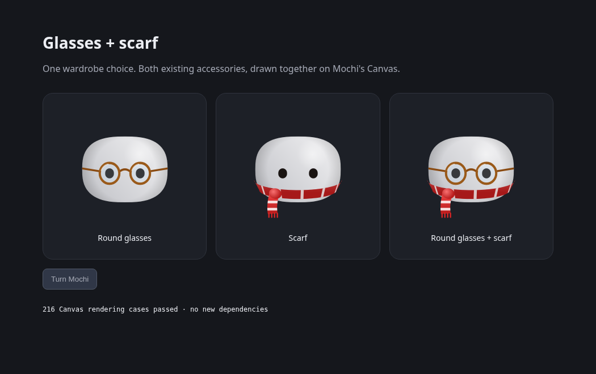

# Add a glasses and scarf combination to Mochi’s wardrobe

Choosing glasses currently replaces the scarf. This adds one wardrobe choice, **Round glasses + scarf**, that draws both existing accessories together on macOS and Windows/Linux.

The new `roundGlassesScarf` value reuses each accessory’s drawing, fade and front/behind projection. The existing outfit IDs and seasonal Auto remain unchanged. The new choice fits the existing wardrobe row; its label is translated, and the phone preference allow-list stays in sync with the shared Swift enum.

Validation:
- Swift wardrobe tests and native Swift Canvas rendering passed in [the focused review workflow](https://github.com/Jose-SMG/Mochi-test/actions/runs/42377284944).
- Frontend tests, TypeScript, localization and release-note checks passed.
- The included development preview checks 216 actual Canvas pixel comparisons across sizes, head turns, presence and mailbox morph. Run Vite in `windows/` and open `/dev/accessory-combination.html`.

This is one built-in combination, not a general wardrobe layering system. It has no room, WebView, Three.js, new dependency, app identity or release change.

Related wardrobe work: #1025 adds skin data behind an adapter, #737 adds body skins, and #738 adds SVG hats. This targets current main and keeps the existing renderers. Their selection-list changes will need to be retained when rebasing; compatibility with those unmerged PRs is not claimed as verified. Older phone clients may show their existing fallback for the new choice.
