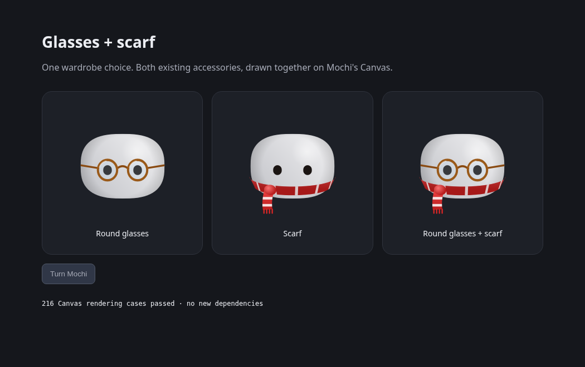

# Canvas accessory contribution

The focused candidate adds one wardrobe choice, **Round glasses + scarf**, using the existing accessories on both macOS SwiftUI Canvas and Windows/Linux Canvas 2D. It leaves seasonal Auto and existing outfit IDs intact, adds a translated label, and keeps the existing phone preference allow-list in sync. The room and preview identity changes are excluded.

[Source branch](https://github.com/Jose-SMG/Mochi-test/tree/review/canvas-accessory-combination) · [Small diff against upstream](https://github.com/Jose-SMG/Mochi-test/compare/review/coucou-0.6-base...review/canvas-accessory-combination)

The capture uses the real Canvas engine from candidate commit `245f21a1d1ba7d54ad155a19fb0838d6533a9530`, not the Three.js room. Its development preview checks 216 Canvas pixel comparisons across head turns, scale, presence and morph. Open `windows/dev/accessory-combination.html` with the Vite dev server to reproduce it. Wardrobe persistence, localization and TypeScript checks pass locally; native Swift checks run in the dedicated review workflow.

The implementation is 203 added lines across 11 files, including translations, tests and the development preview. The renderer reuses the existing draw functions for each front/behind pass and their animations. It does not add dependencies or replace the wardrobe UI.

## Existing wardrobe proposals

- #1025 keeps built-in drawings behind a `skin-outfits.ts` adapter and adds data-driven skins. This candidate is a built-in accessory choice; it does not add another skin engine or Settings page.
- #737 adds full body skins. This candidate does not recolor Mochi or change those body renderers.
- #738 adds SVG hats. This candidate uses the already implemented glasses/scarf paths and does not introduce SVG assets or hats.

All three proposals touch the shared selection list and its tests; integration will need a small rebase to retain each proposal's added IDs. This candidate targets upstream main, rather than including unrelated unmerged PR commits. Compatibility is not claimed as verified.

An actual upstream PR requires a real fork in GitHub's Coucou repository network. This independent repository is not a fork, so its branch alone cannot create that upstream PR.
